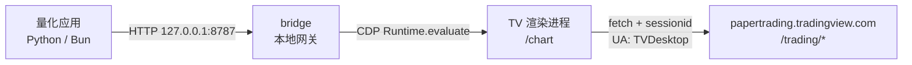

# tv-paper-api

用外部程序驱动 **TradingView 桌面版**的 Paper Trading（模拟交易）：本地 HTTP 接口 + 命令行，
买、卖、做多、做空、平仓、反手、限价、撤单全部可用。

面向量化应用对接：`POST http://127.0.0.1:8787/order` 就完成一次模拟下单。

> 非官方接口。路径与字段是从桌面客户端逆向得到的，TradingView 不做任何兼容承诺。

## 原理

TradingView 桌面版（3.5.0 = Electron 41.7.1）的纸交易**不是本地模拟**，而是对远端 REST 的普通 HTTPS 调用：

```
渲染进程 (https://www.tradingview.com/chart/)
   └─ fetch  POST https://papertrading.tradingview.com/trading/place/<accountId>
        credentials: 'include'          ← sessionid cookie 即凭证
        Content-Type: application/x-www-form-urlencoded; charset=UTF-8
        body: JSON 字符串（声明是 form，实际发 JSON）
```

证据来自客户端自身 bundle `paper.<hash>.js` 的模块 `202391`（`paperFetch`）：

```js
const s = { headers: new Headers({"Content-Type":"application/x-www-form-urlencoded; charset=UTF-8"}),
            method: r, credentials: "include" };
s.body = JSON.stringify(e.body);
new URL(`${TRADING_URLS[segment]}/${path}`, location.origin)
```

- `TRADING_URLS` 来自页面 `window.initData.settings`：
  `{ free: https://papertrading-free.tradingview.com, pro: https://papertrading.tradingview.com }`
- 凭证是 cookie `sessionid`（Domain `.tradingview.com`）。无 API key、无 OAuth、无 WebSocket 下单。
- **不需要额外鉴权头**：登录后 `sessionid` 即全部凭证。未登录时会返回
  `401 {"err_code":"missed_x_userid_header"}`，容易被误判成缺头，实际是没登录会话。
  也**不要**手动加 `X-UserId`：该端点的 CORS 预检只放行 `X-UseNewAuth`，多一个自定义头请求就发不出去。

### 为什么不直连 HTTP

| 原因 | 说明 |
|---|---|
| 凭证 | `sessionid` 是 httpOnly + Secure cookie，只存在于桌面 profile，外部拿不到也不该拿 |
| 指纹 | 请求带 `User-Agent: ... TVDesktop/3.5.0`，服务端按 origin + cookie 组合校验 |
| 变更 | 路径无版本号、字段是内部约定、无文档无 SLA |

所以本项目**给桌面版开 Chrome DevTools Protocol 端口，在渲染进程里执行 fetch**：
凭证、UA、cookie 全部由 TV 自己带，外部零凭证。



## 安装

需要 Bun ≥ 1.3。

```bash
git clone https://github.com/CN059/tv-paper-api
cd tv-paper-api
bun install
```

## 先选运行模式

| 模式 | 需要什么 | 适合 |
|---|---|---|
| **attached**（默认） | 本机跑着 TradingView 桌面版，且带调试端口启动 | 自己电脑上边看图边自动化 |
| **headless** | 只需要一个抓取下来的 `sessionid` | 服务器 / 容器 / 无桌面环境 |

**只想在服务器上跑量化** → 直接看下一节「从零获取凭据」，然后跳到「网关 API」。
**只想在自己电脑上用** → 走下面这条，不需要处理任何凭据：

```bash
# 1) 完全退出 TradingView（托盘图标也要退）
#    调试端口只能在启动时开启，已运行的实例不会接受
powershell -ExecutionPolicy Bypass -File scripts/launch-tv.ps1 -Port 9333

# 2) 启动网关
bun run bridge

# 3) 下单
curl -X POST http://127.0.0.1:8787/order \
  -H "Content-Type: application/json" \
  -d '{"symbol":"NASDAQ:AAPL","side":"buy","qty":1}'
```

`requestSingleInstanceLock` 生效：TV 已在运行时，新进程只会把参数转给旧实例，端口不会打开。

## 从零获取凭据

目标：让一台**没有浏览器、没有桌面版**的机器能调用纸交易接口。

原理：接口只认一个 cookie `sessionid`（实测单个即可，`sessionid_sign`、`device_t` 都不是必需，
通常数月有效）。把这个 cookie 加密后搬过去即可。

涉及两个角色：

| 角色 | 是什么 | 持有什么 |
|---|---|---|
| **A：有 TradingView 的机器** | 你日常看盘的那台 | 公钥（可公开） |
| **B：部署机** | 要跑 API 的服务器 | 私钥（绝不外传） |

用非对称加密：**A 只能加密，B 才能解密**。所以密文经过 A、传输链路、磁盘都不怕。

### 1. 在 B 上生成密钥对

```bash
bun run credctl keygen
```

```json
{
  "publicKey": "<32 字节，base64>",
  "privateKey": "<PKCS#8，base64>"
}
```

- `privateKey` → 留在 B，存成环境变量 `TV_CRED_PRIVKEY`
- `publicKey` → 拷到 A，用于加密

> 每次 `keygen` 都产生新的一对。换一对，旧的凭据就解不开了，需要重新 capture。

### 2. 在 A 上抓取并加密

A 上的 TradingView 要**已经登录**，并且**带着调试端口在跑**（否则读不到 cookie）：

```bash
# A 上也装一份这个项目
git clone https://github.com/CN059/tv-paper-api && cd tv-paper-api && bun install

# 退出 TV 后带端口重启（Windows）
powershell -ExecutionPolicy Bypass -File scripts/launch-tv.ps1 -Port 9333

# 抓取并加密
bun run credctl capture --to=<公钥> --out=./cred.enc
```

```text
sealed credential written to ./cred.enc (mode 600)
session expires: 2027-01-31T12:09:57.411Z
envelope: tvcred1.eyJ2IjoxLCJlcGsiOi...   # 复制这串也能用
```

三个产物，用途不同：

| 产物 | 用途 |
|---|---|
| `cred.enc` | 密文文件，**这个才需要传到 B** |
| `session expires` | 到期时间，记下来以便提前重抓 |
| `envelope: tvcred1.…` | 同一份密文的文本形式，方便直接粘贴 |

`cred.enc` 权限是 `0600`。明文 cookie 从不落盘、不回显。

可以顺带固定账户，省掉每次查询：

```bash
bun run credctl capture --to=<公钥> --account=<accountId> --out=./cred.enc
```

### 3. 把密文传到 B

```bash
scp cred.enc user@server:~/.tv-paper/cred.enc
chmod 600 ~/.tv-paper/cred.enc     # 服务器上再收紧一次
```

也可以直接粘贴 `tvcred1.…` 那串文本，用 `--credfile` 指向保存的文件效果相同。

### 4. 在 B 上验证

解封 + 真实调用一次，确认凭据可用（而不只是能解密）：

```bash
export TV_CRED_PUBKEY=<公钥>
export TV_CRED_PRIVKEY=<私钥>

bun run credctl verify --credfile=./cred.enc
```

```json
{
  "ok": true,
  "segment": "pro",
  "accounts": 1,
  "hint": "account id available in the account list"
}
```

`ok: false` 说明 cookie 过期或被登出 —— 回第 2 步重新 capture。

### 5. 在 B 上启动，此后不再需要 TradingView

```bash
export TV_CRED_PUBKEY=<公钥>
export TV_CRED_PRIVKEY=<私钥>
export TV_CREDFILE=~/.tv-paper/cred.enc

bun run bridge
```

```text
tv-paper-api bridge on http://127.0.0.1:8787  (mode headless, token off)
```

看到 `mode headless` 就对了 —— 这台机器上没有浏览器也没有 TradingView。

### 单机简化路径

A 和 B 是同一台机器时，不必折腾传输：

```bash
# 直接给 cookie，跳过加密信封（仅适合临时调试）
export TV_SESSIONID=<sessionid>
bun run bridge
```

想从运行中的 TV 里取这个值：

```bash
bun run credctl capture --to=<公钥> --out=./cred.enc   # 然后解开看 cookie
```

### 环境变量

| 变量 | 说明 |
|---|---|
| `TV_SESSIONID` | 直接给 cookie（或裸 `sessionid` 值），跳过加密信封 |
| `TV_CREDFILE` | 密封凭据文件路径 |
| `TV_CRED_PUBKEY` / `TV_CRED_PRIVKEY` | 解封所需的密钥对 |
| `TV_SEGMENT` | `pro`（默认）或 `free` |
| `TV_ACCOUNT` | 固定使用的账户 id，省掉每次查询 |
| `BRIDGE_PORT` / `BRIDGE_HOST` / `BRIDGE_TOKEN` | 网关监听与鉴权 |
| `TVCDP_PORT` | attached 模式的调试端口 |

## 网关 API

网关默认 `http://127.0.0.1:8787`，只监听本机。返回统一为 `{ ok, ... }`。

| 方法 | 路径 | body | 说明 |
|---|---|---|---|
| GET | `/health` | – | 运行模式与后端状态 |
| GET | `/accounts` | – | 账户列表（含余额） |
| GET | `/positions?account=` | – | 持仓 + 挂单 |
| POST | `/order` | `{symbol, side, qty, type?, price?, sl?, tp?, account?}` | 下单 |
| POST | `/close` | `{symbol, qty?, account?}` | 平仓 |
| POST | `/reverse` | `{symbol, account?}` | 多空翻转 |
| POST | `/cancel` | `{id, account?}` | 撤单 |

**状态码**：`200` 成功 · `400` 参数不合法 · `401` 网关 token 错误 ·
`502` 上游拒单或后端不可用 · `500` 其他。

### GET /health

```bash
curl -s http://127.0.0.1:8787/health
```

```json
// headless 模式
{ "ok": true, "mode": "headless", "segment": "pro", "account": null }

// attached 模式
{ "ok": true, "mode": "attached", "tvTarget": "https://www.tradingview.com/chart/", "cdpPort": 9333 }
```

### GET /accounts

```bash
curl -s http://127.0.0.1:8787/accounts
```

```json
{
  "ok": true,
  "segment": "pro",
  "accounts": [
    {
      "accountId": 10000001,
      "default": true,
      "balance": 99800.5,
      "initialBalance": 100000,
      "hidden": false,
      "marginCallEnabled": false,
      "segment": "pro",
      "commissions": { "stocks": { "type": "disabled" } }
    }
  ]
}
```

账户对象**原样转发服务端字段**（`commissions`、`marginCallEnabled`、`segment` 等随套餐变化），
这里只列常用的。`accountId` 是数字；把它传给其他接口时用字符串或数字都可以。

不传 `account` 时，后续下单会自动选 `default: true` 且未隐藏的那个。

### GET /positions

```bash
curl -s "http://127.0.0.1:8787/positions"
```

```json
{
  "ok": true,
  "accountId": "paper-1",
  "balance": 99800.5,
  "positions": [
    { "symbol": "NASDAQ:AAPL", "qty": 1, "price": 180.2, "pl": 12.5 }
  ],
  "orders": [
    { "id": 42, "symbol": "NASDAQ:AAPL", "type": "limit", "side": "buy", "qty": 2, "price": 175, "status": "working" }
  ]
}
```

`qty` 带符号：**正数是多头，负数是空头**。持仓与挂单对象同样原样转发，
所以会出现 `close-date`、`marginRate`、`pointvalue` 这类带连字符的原始字段名。

### POST /order

```bash
curl -X POST http://127.0.0.1:8787/order \
  -H "Content-Type: application/json" \
  -d '{"symbol":"NASDAQ:AAPL","side":"buy","qty":1}'
```

```json
{
  "ok": true,
  "accountId": "10000001",
  "request": { "symbol": "NASDAQ:AAPL", "type": "market", "qty": 1, "side": "buy" },
  "response": { "id": 7, "symbol": "NASDAQ:AAPL", "side": "buy", "type": "market", "status": "pending" }
}
```

参数：

| 字段 | 必填 | 说明 |
|---|---|---|
| `symbol` | 是 | `EXCHANGE:TICKER`，不能含空格。如 `NASDAQ:AAPL`、`FX_IDC:USDJPY`、`BINANCE:BTCUSDT` |
| `side` | 是 | `buy` 或 `sell` |
| `qty` | 是 | 正数 |
| `type` | 否 | `market`（默认）/ `limit` / `stop` |
| `price` | `limit`/`stop` 必填 | 委托价 |
| `sl` / `tp` | 否 | 止损 / 止盈价 |
| `account` | 否 | 指定账户，否则用默认账户 |

```bash
# 限价单 + 止损止盈
curl -X POST http://127.0.0.1:8787/order -H "Content-Type: application/json" \
  -d '{"symbol":"BINANCE:BTCUSDT","side":"sell","qty":0.01,"type":"limit","price":60000,"sl":61000,"tp":58000}'
```

> **市价单是异步的**。返回的 `status` 通常是 `pending`，1–5 秒后才成交。
> 量化侧必须轮询 `/positions` 确认，不要假定返回即持仓到位。

### POST /close

```bash
# 全部平掉
curl -X POST http://127.0.0.1:8787/close -H "Content-Type: application/json" \
  -d '{"symbol":"NASDAQ:AAPL"}'

# 平掉指定数量
curl -X POST http://127.0.0.1:8787/close -H "Content-Type: application/json" \
  -d '{"symbol":"NASDAQ:AAPL","qty":1}'
```

### POST /reverse

```bash
curl -X POST http://127.0.0.1:8787/reverse -H "Content-Type: application/json" \
  -d '{"symbol":"NASDAQ:AAPL"}'
```

一次调用把多头翻成等量空头，反之亦然。

### POST /cancel

```bash
curl -X POST http://127.0.0.1:8787/cancel -H "Content-Type: application/json" \
  -d '{"id":42}'
```

### 错误示例

```json
// 400 参数问题（调用方的错）
{ "ok": false, "error": "qty must be a positive number" }
{ "ok": false, "error": "side must be 'buy' or 'sell'" }
{ "ok": false, "error": "price is required for limit orders" }

// 502 上游拒单（服务端的事）
{ "ok": false, "status": 400, "error": "paper request failed: trading/place/10000001 (HTTP 400)",
  "detail": { "err_code": "unspecified_bad_request", "error": "malformed request syntax" } }
```

## 从量化程序调用

网关就是个普通 HTTP 服务，任何语言都能用。

```python
# Python
import requests

BASE = "http://127.0.0.1:8787"

def buy(symbol, qty):
    r = requests.post(f"{BASE}/order", json={"symbol": symbol, "side": "buy", "qty": qty}, timeout=15)
    data = r.json()
    if not data["ok"]:
        raise RuntimeError(data)
    return data["response"]

def position(symbol):
    """Signed position size; 0 when flat. Positive = long."""
    snap = requests.get(f"{BASE}/positions", timeout=15).json()
    for p in snap.get("positions", []):
        if p["symbol"] == symbol:
            return p["qty"]
    return 0
```

```typescript
// Bun / Node
const BASE = 'http://127.0.0.1:8787';

const place = async (order: { symbol: string; side: 'buy' | 'sell'; qty: number }) => {
  const res = await fetch(`${BASE}/order`, {
    method: 'POST',
    headers: { 'Content-Type': 'application/json' },
    body: JSON.stringify(order),
  });
  const data = await res.json();
  if (!data.ok) throw new Error(data.error);
  return data.response;
};
```

完整示例见 `examples/client.py`。

### 目标仓位模式

纸交易是净持仓语义，最省事的接法是把「目标仓位」换算成 delta：

```python
def rebalance(symbol, target):
    current = position(symbol)
    delta = target - current
    if delta == 0:
        return None
    side = "buy" if delta > 0 else "sell"
    return buy(symbol, abs(delta)) if side == "buy" else sell(symbol, abs(delta))
```

想直接反手（多 → 等量空）就用 `/reverse`，一次调用完成。

### 轮询成交

市价单返回 `status: "pending"`，必须自己确认：

```python
import time

def wait_filled(symbol, qty, timeout=10):
    deadline = time.time() + timeout
    while time.time() < deadline:
        if position(symbol) == qty:
            return True
        time.sleep(0.5)
    return False
```

## 命令行

```bash
bun run tvctl accounts
bun run tvctl positions
bun run tvctl place --symbol=NASDAQ:AAPL --side=buy --qty=1
bun run tvctl place --symbol=BTCUSD --side=sell --qty=0.01 --sl=60000 --tp=55000
bun run tvctl place --symbol=NASDAQ:AAPL --side=buy --qty=1 --type=limit --price=100
bun run tvctl close --symbol=NASDAQ:AAPL
bun run tvctl reverse --symbol=NASDAQ:AAPL
bun run tvctl cancel --id=<orderId>
```

端口不是 9333 时用 `--port=<n>` 或 `TVCDP_PORT`。

stdout 是纯 JSON（`bun run` 的横幅走 stderr），可以直接管道给 `jq`：

```bash
# 取默认账户余额
bun run tvctl positions 2>/dev/null | jq -r .balance

# 平掉所有多头持仓
bun run tvctl positions 2>/dev/null \
  | jq -r '.positions[] | select(.qty > 0) | "\(.symbol) \(.qty)"' \
  | while read -r sym qty; do bun run tvctl place --symbol="$sym" --side=sell --qty="$qty" 2>/dev/null; done
```

退出码：`0` 成功 · `1` 请求被拒 · `2` 用法错误。

## 做多 / 做空

TradingView 没有独立的「做多」「做空」接口，它是**净持仓**语义：

| 目标 | 做法 |
|---|---|
| 开多 | `side: buy`，当前无空头持仓 |
| 开空 | `side: sell`，当前无多头持仓 |
| 平仓 | `/close`（`trading/close_position`） |
| 多↔空翻转 | `/reverse`（`trading/reverse`），一次调用把 `-n` 变成 `+n` |

量化侧有两种接法：把「目标仓位」换算成 delta 单，或持仓方向不同时直接调 `/reverse`。

## 底层接口（逆向所得）

除标注 GET 外均为 POST，`<id>` 为 accountId。

| 路径 | body | 用途 |
|---|---|---|
| `trading/accounts` | `{}` | 账户列表 |
| `trading/account/<id>` | `{}` | 快照：`positions` + `orders` + balance |
| `trading/place/<id>` | 见下 | 下单 |
| `trading/modify/<id>` | `{id, ...order}` | 改单 |
| `trading/cancel/<id>` | `{id}` | 撤单 |
| `trading/close_position/<id>` | `{symbol, qty}` | 平仓 |
| `trading/reverse/<id>` | `{symbol}` | 多空翻转 |
| `trading/modify_position/<id>` | `{symbol, sl, tp, levels?}` | 改持仓止盈止损 |
| `trading/get_trades/<id>` | `{}` | 成交明细 |
| `trading/orders_history/<id>` | `{symbol?, from?, to?, ...}` | 历史委托 |
| `trading/get_account_history/<id>` | `{start_date, records_count}` | 账户流水 |
| `trading/transactions/<id>` | `{fromDate?}` | 资金流水 |
| `trading/accounts/<id>/equity/history` | GET `?from=` | 权益曲线（二进制 16B/点） |
| `trading/accounts/<id>/risk` | GET | 保证金/风险指标 |
| `trading/margin/rate` | GET `?accountId=&symbol=` | 单标的保证金率 |
| `trading/margin/list` | GET `?accountId=` | 全部保证金率 |
| `trading/reset_account/<id>` | `{clientRequestId}` | 重置模拟账户 |
| `trading/request_currency_rates` | – | 汇率 |

下单 body（逆向自 bundle 内序列化函数 `ut()`）：

```json
{
  "symbol": "NASDAQ:AAPL",
  "type": "market" | "limit" | "stop",
  "side": "buy" | "sell",
  "qty": 1,
  "price": 123.45,
  "sl": 120.0,
  "tp": 130.0,
  "levels": [{"tp": 0, "sl": 0, "qty": 0, "oco": 0}],
  "outside_rth": false,
  "outside_rth_tp": false,
  "expiration": 1730000000
}
```

`levels`（分批止盈止损）与 `sl`/`tp` 互斥。`expiration` 单位为秒，缺省由服务端按周期计算。

## 目录

```
src/page-shim.ts    协议核心：注入渲染进程与 headless 调用共用同一份实现
src/cdp.ts          CDP 客户端：找 chart 页、求值、取回结果
src/credential.ts   密封信封：X25519 + HKDF + AES-256-GCM
src/credctl.ts      凭据工具：keygen / capture / verify
src/driver.ts       参数校验 + 两种传输（attached / headless）
src/bridge.ts       Bun HTTP 网关 127.0.0.1:8787
src/tvctl.ts        命令行
src/types.ts        线上字段类型
scripts/launch-tv.ps1  带调试端口启动 TradingView（Windows）
test/               bun test：单元 + 凭据 + headless + 端到端
examples/client.py  Python 对接示例
```

## 测试

```bash
bun test          # 47 项：单元 + 凭据信封 + headless + 端到端
bun run typecheck
```

- **headless 测试**替换全局 `fetch` 为记录桩，断言 URL、方法、Cookie、Origin/Referer、
  User-Agent，以及“不发多余鉴权头”这一约束 —— 不需要网络。
- **端到端测试**在渲染进程里替换 `window.fetch`，逐字段断言实际发出的请求；
  TV 未开调试端口时整组跳过。
- 两者都**不会真实下单**。

## 数据与脱敏

本仓库不含任何凭证或真实账户数据：

- **仓库里无凭证**：没有 token、cookie、密码、私钥。凭据只在你自己的机器上产生，
  以密文形式传递，绝不进入仓库（`.gitignore` 已排除 `*.enc`、`.env*`、`cred*`）。
- **凭据只在内存里解密**：headless 模式启动时解封一次，之后只存在于进程内存，
  不写日志、不落盘、不回显。`credctl capture` 输出的密文文件权限为 0600。
- **无账户标识**：文档、示例、测试里的 accountId、订单号、余额、持仓全部是占位值
  （`paper-1`、`42`、`100000` 之类）；真实账号 id、订单 id 在发布前已从文档中清除。
- **无主机名**：不包含部署路径、内网地址、SSH 目标等环境信息。
- **可配置而非硬编码**：端口、token、超时、凭据路径全部走环境变量
  （`BRIDGE_PORT`、`BRIDGE_TOKEN`、`BRIDGE_TIMEOUT_MS`、`TVCDP_PORT`、`TV_CREDFILE` …），
  仓库里没有本地配置。

> 抓取到的 `sessionid` 等价于你 TradingView 账户的登录态。它只能解密给持有对应私钥的部署机，
> 但**请把它当作密码对待**：不要提交、不要贴在 issue 里、不要放进截图。

如果你要基于本项目出图或写文章，请同样替换掉自己的 accountId 与订单号。

## 注意

1. **调试端口等价于交易权限**。`--remote-debugging-port` 让本机任意进程都能控制该渲染进程
   （读页面、下单）。只监听 127.0.0.1、用完即关；网关建议设 `BRIDGE_TOKEN`，别暴露到局域网。
2. **接口无版本契约**。`src/page-shim.ts` 直接发 fetch、不依赖 webpack 模块号，小版本升级大概率仍可用；
   路径/字段变了要重新抓 bundle。
3. **市价单是异步的**。`trading/place` 返回 `status: "pending"`，实测 1–5s 后成交。量化侧要轮询
   `account/<id>` 确认，不能假定下单返回即持仓到位。
4. **高频下单可能触发服务端限制**。量化侧需自行限速与幂等。
5. **`outside_rth`**：bundle 存在 `out_of_session` 错误码，常规时段外下单预计需显式传
   `outside_rth: true`（未在盘前/盘后实测）。
6. **仅供个人研究**。非公开接口，不要在自动化里绕过任何计费或权限控制。

## License

MIT
